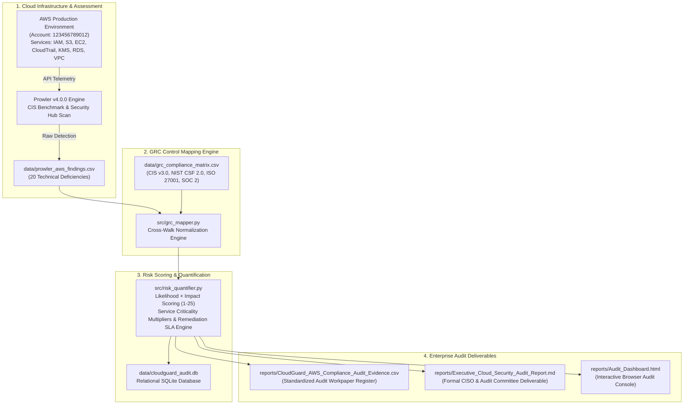

# CloudGuard — Continuous Cloud Security & GRC Assurance Platform
> **Continuous Technical Cloud Security Audit, Multi-Framework GRC Control Mapping, and Executive Risk Governance**

[](#-multi-framework-control-mapping-matrix)
[](https://github.com/prowler-cloud/prowler)
[](#-sample-audit-findings--workpaper-register)
[](#-database-schema--records)
[](https://github.com/Nishankhadgi)
[](LICENSE)

---

## 📌 Executive Summary & Problem Statement

In enterprise cloud environments, automated security scanning tools (such as Prowler, AWS Security Hub, or Prisma Cloud) generate voluminous technical alerts. However, **Internal Audit, Technology Risk Advisory, C-level Executives, and the Board of Directors** cannot consume raw JSON or CLI stdout. They require:
- Traceable evidence mapped directly to authorized cybersecurity control frameworks.
- Rigorous assessment of operational control effectiveness (ITGC).
- Business risk quantification (Likelihood × Impact).
- Clear management remediation ownership and strict SLA enforcement.

**CloudGuard** closes this operational gap. It ingests automated cloud scan outputs, executes an automated GRC cross-walk engine, computes risk scores across asset tiers, and generates formal audit deliverables—including an audit-ready CSV workpaper register, an executive CISO memorandum, a relational SQLite audit repository, and a live interactive web dashboard.

---

## 🏗️ Architecture & Audit Lifecycle Workflow



---

## 🎯 Core Capabilities & Audit Methodology

1. **Multi-Standard Cross-Walk Normalization:**  
   Every technical finding is simultaneously linked to four premier compliance frameworks:
   - **CIS AWS Foundations Benchmark v3.0**
   - **NIST Cybersecurity Framework (CSF) 2.0**
   - **ISO/IEC 27001:2022 (Annex A Controls)**
   - **AICPA SOC 2 (2017 Trust Services Criteria - CC & A Series)**
2. **Quantitative Risk Scoring (Likelihood × Impact = Inherent Risk):**  
   Evaluates vulnerabilities on an objective 1–25 risk scale, applying asset criticality weighting (e.g., IAM Root & Production RDS receive heightened impact weight).
3. **Traceable Audit Workpapers:**  
   Issues standardized workpaper IDs (`WP-IAM-001`, `WP-S3-002`, `WP-EC2-003`) containing control objectives, testing procedures, resource ARNs, and management recommendations.
4. **Remediation SLA Governance:**  
   Enforces remediation deadlines with aging calculations:
   - 🔴 **Critical Severity (Score 20–25):** 7 calendar days
   - 🟠 **High Severity (Score 12–19):** 30 calendar days
   - 🟡 **Medium Severity (Score 6–11):** 60 calendar days
   - 🔵 **Low Severity (Score 1–5):** 90 calendar days
5. **Relational Evidence Store (SQLite):**  
   Normalized relational database (`data/cloudguard_audit.db`) storing engagements, findings, control requirements, and remediation tracking.
6. **Executive Web Console:**  
   Interactive HTML dashboard with instant keyword filtering, severity badges, testing modals, and CSV export.

---

## 📊 Multi-Framework Control Mapping Matrix

| Technical Finding | AWS Service | CIS AWS v3.0 | NIST CSF 2.0 | ISO 27001:2022 | AICPA SOC 2 | Remediation SLA |
| :--- | :--- | :--- | :--- | :--- | :--- | :--- |
| **Root Account MFA Disabled** | IAM | CIS 1.5 | PR.AA-01 | A.5.15 | CC6.1 | 7 Days (Critical) |
| **S3 Public Access Block Disabled** | S3 | CIS 2.1.5 | PR.DS-01 | A.8.12 | CC6.6 | 7 Days (Critical) |
| **SSH (Port 22) Ingress from 0.0.0.0/0** | EC2 | CIS 5.2 | PR.AC-05 | A.8.20 | CC6.6 | 7 Days (Critical) |
| **RDS Instance Storage Unencrypted** | RDS | CIS 2.3.1 | PR.DS-01 | A.8.24 | CC6.1 | 7 Days (Critical) |
| **IAM Policy Wildcard Administrator** | IAM | CIS 1.16 | PR.AA-01 | A.5.15 | CC6.3 | 7 Days (Critical) |
| **S3 Data Write Events Not Logged** | CloudTrail | CIS 3.8 | DE.AE-03 | A.8.15 | CC7.2 | 30 Days (High) |
| **KMS Customer Key Rotation Disabled** | KMS | CIS 2.8 | PR.DS-02 | A.8.24 | CC6.1 | 30 Days (High) |
| **IAM User Access Key Unused >90 Days** | IAM | CIS 1.13 | PR.AA-05 | A.5.17 | CC6.3 | 30 Days (High) |
| **S3 Default Bucket SSE-KMS Disabled** | S3 | CIS 2.1.1 | PR.DS-01 | A.8.24 | CC6.1 | 30 Days (High) |
| **GuardDuty Disabled in Active Region** | GuardDuty | CIS 3.4 | DE.CM-01 | A.8.16 | CC7.2 | 30 Days (High) |
| **CloudTrail Log File Integrity Disabled** | CloudTrail | CIS 3.2 | PR.DS-06 | A.8.15 | CC7.2 | 30 Days (High) |
| **Default EBS Volume Encryption Disabled**| EC2 | CIS 2.2.1 | PR.DS-01 | A.8.24 | CC6.1 | 30 Days (High) |
| **Console Users Without MFA Active** | IAM | CIS 1.10 | PR.AA-01 | A.5.15 | CC6.1 | 30 Days (High) |
| **EC2 IMDSv1 Enabled (Tokenless)** | EC2 | CIS 5.4 | PR.PS-01 | A.8.20 | CC6.8 | 60 Days (Medium) |
| **VPC Flow Logs Disabled** | VPC | CIS 3.9 | DE.AE-03 | A.8.15 | CC7.2 | 60 Days (Medium) |
| **IAM Password Minimum Length < 14** | IAM | CIS 1.8 | PR.AA-01 | A.5.17 | CC6.1 | 60 Days (Medium) |
| **S3 Object Versioning Suspended** | S3 | CIS 2.1.2 | PR.DS-10 | A.8.14 | A1.2 | 60 Days (Medium) |
| **RDS Instance Single-AZ Deployment** | RDS | CIS 2.3.3 | PR.IR-01 | A.8.14 | A1.2 | 60 Days (Medium) |
| **S3 Audit Archive Lacks Glacier Rule** | S3 | CIS 2.1.4 | PR.DS-08 | A.8.10 | A1.2 | 90 Days (Low) |
| **AWS Support Escalation Role Missing** | IAM | CIS 1.17 | RS.CO-02 | A.5.24 | CC7.4 | 90 Days (Low) |

---

## 📋 Sample Audit Findings & Workpaper Register

### Workpaper Excerpt: `WP-IAM-001`
- **Finding Title:** Root Account MFA is Not Enabled
- **Resource ARN:** `arn:aws:iam::123456789012:root`
- **Inherent Risk Score:** **25 / 25 (CRITICAL)**
- **Control Objectives:**
  - **CIS AWS Foundations v3.0:** Control 1.5
  - **NIST CSF 2.0:** PR.AA-01 (Identity & Authenticity)
  - **ISO/IEC 27001:2022:** A.5.15 (Access Control)
  - **AICPA SOC 2:** CC6.1 (Logical Access Controls)
- **Audit Testing Procedure:** Inspected AWS IAM Credential Report and queried `GetAccountSummary` API. Verified that `AccountMFAEnabled` flag returned `false`.
- **Business Risk:** Compromise of root credentials bypasses all secondary IAM policies, enabling full environment compromise, ransomware encryption of EBS snapshots, and irrecoverable deletion of S3 archives.
- **Management Remediation Action:** Enable a FIPS 140-2 Level 3 hardware security key or enterprise virtual MFA authenticator on the root account. Secure emergency recovery keys in an enterprise vault.

---

## 🗄️ Database Schema & Records

The relational SQLite database (`data/cloudguard_audit.db`) contains 3 core tables:

```sql
-- Audit Engagement Header
CREATE TABLE audit_engagements (
    engagement_id TEXT PRIMARY KEY,
    audit_title TEXT,
    lead_auditor TEXT,
    target_account_id TEXT,
    assessment_date TEXT,
    status TEXT
);

-- Compliance Control Matrix
CREATE TABLE compliance_controls (
    check_id TEXT PRIMARY KEY,
    cis_v3_control TEXT,
    nist_csf_2_control TEXT,
    iso_27001_control TEXT,
    soc_2_criteria TEXT,
    control_objective TEXT,
    audit_testing_procedure TEXT,
    sla_days INTEGER,
    default_owner TEXT
);

-- Audit Findings & Workpapers Register
CREATE TABLE findings_register (
    workpaper_ref TEXT PRIMARY KEY,
    finding_id TEXT,
    service TEXT,
    check_id TEXT,
    check_title TEXT,
    severity TEXT,
    inherent_risk_score INTEGER,
    business_risk_tier TEXT,
    resource_arn TEXT,
    technical_description TEXT,
    remediation_guidance TEXT,
    owner TEXT,
    remediation_due_date TEXT,
    status TEXT,
    FOREIGN KEY(check_id) REFERENCES compliance_controls(check_id)
);
```

---

## 📁 Repository Structure
